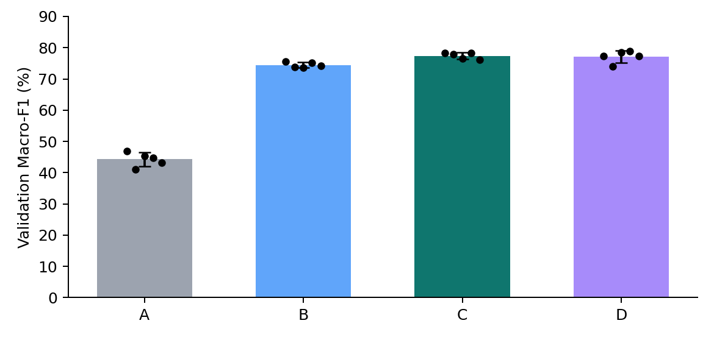
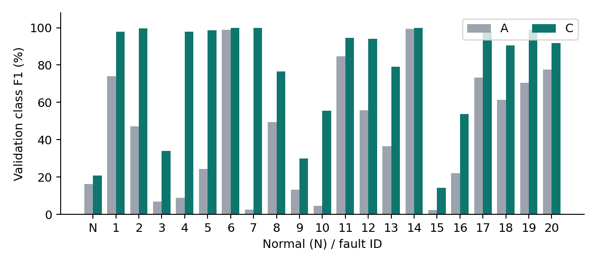

# Graph Learning with Quality and Consistency Awareness for Safety Risk Identification

Wu Zhou, Yuxiang Wang, Jisheng Qin*, Zijie Liu and Ruibing Zhao 
School of Artificial Intelligence, Chuzhou University, Chuzhou, Anhui, China 
Corresponding author: jisheng.qin@chzu.edu.cn

*Evidence-based revision, 16 November 2026. This manuscript distinguishes completed historical tests from the new validation study. Additional held-out evaluations and controlled training runs are scheduled separately; their results are not assumed below. This is a review draft, not a final camera-ready version.*

## Abstract

Process-variable graphs support fault classification when chemical process observations are noisy, missing, drifting, or temporally misaligned. We study a quality- and consistency-aware heterogeneous graph model (QC-HGT) on the Tennessee Eastman Process extended500 dataset. The model represents sensors, manipulated variables, and process units, and combines observable-descriptor reliability estimation with relation-conditioned evidence consistency. Auxiliary quality targets are used only during training. Audited historical five-seed experiments show higher mean Macro-F1 for the original QC-HGT than the evaluated graph baselines under clean training, although the CNN temporal baseline performs better. Under mixed-degradation training, the consistency-only variant outperforms the full model, so these results do not establish a benefit from jointly enabling both modules. A new controlled five-seed input study identifies a substantial representation bottleneck: fixed training-set scaling with physical-variable and process-unit identities increases validation Macro-F1 from 0.4426 ± 0.0219 to 0.7740 ± 0.0100. Adding a temporal convolutional encoder does not further improve mean Macro-F1 under the fixed budget. Normal-condition false alarms remain high. The input-enhanced model's held-out generalization and the incremental contribution of its quality and consistency modules require the separately specified evaluations.

**Index terms:** fault diagnosis; heterogeneous process graph; data quality; evidence consistency; input representation; Tennessee Eastman Process.

## I. Introduction

Chemical process measurements reflect interactions among material flows, control actions, and connected equipment [1]. Process-topology graph models make these dependencies available to fault classifiers [2], [3]. However, degraded measurements can propagate through graph aggregation. A small attention weight can reflect either unreliable observations or incompatible evidence between connected variables; these are distinct modeling questions.

Graph learning with missing features [4], statistical process monitoring [5], graph convolution [6], graph attention [7], relational graph convolution [8], and heterogeneous graph transformers [9] provide relevant foundations. QC-HGT combines a heterogeneous process graph with separately supervised node-reliability and relation-consistency branches. At inference, these branches use observable inputs rather than injected degradation parameters or fault labels.

This revision separates three empirical questions: whether the input representation preserves useful fault information; whether reliability and consistency contribute beyond a shared backbone and input representation; and whether the resulting classifier generalizes to held-out degradation conditions. The completed input study addresses the first question. Historical tests provide a baseline for the latter questions, but do not establish superiority of the new representation on held-out data.

The study provides (i) a process graph with six directed relation types, (ii) observable-input reliability and relation-consistency mechanisms, and (iii) an audited historical evaluation plus a controlled cumulative input study. Joint-module superiority is treated as a hypothesis to test rather than an established contribution.

## II. Method

### A. Window graphs and classification

A run contains 52 process variables. A sample is a window of W = 30 observations, with endpoint label Normal or IDV1–IDV20. Windows are constructed after independent runs have been assigned to training, validation, or testing. The classifier maps a window graph G = (V, E, X, R) to 21 class probabilities.

The graph contains 41 Sensor nodes, 11 Actuator nodes, six Process Unit nodes, and 480 directed edges. Its fixed process mapping is unchanged in the input experiments.

| Relation | Directed endpoints | Reverse handling |
| --- | --- | --- |
| monitors | Sensor → Process Unit | monitored_by |
| controls | Actuator → Process Unit | controlled_by |
| flows_to | Process Unit → Process Unit | None |
| co_monitors | Sensor → Sensor | Both directions |
| monitored_by | Process Unit → Sensor | Reverse of monitors |
| controlled_by | Process Unit → Actuator | Reverse of controls |

### B. Original and enhanced input representations

Each Sensor or Actuator has seven window statistics: mean, population standard deviation, minimum, maximum, linear trend, last value, and last-minus-first difference. Invalid observations are excluded; invalid endpoints use the configured zero fill. Process Unit statistics are averages over attached variables. The original representation applies LayerNorm to the seven statistics before type-specific projection to 64 dimensions. It has no physical-variable or unit-ID embeddings.

The enhanced representation fits a separate mean and scale for each variable using only valid, uncorrupted observations covered by the selected training windows. Overlapping windows do not count a run/time observation more than once. All training classes are included in this fit. The transformation is:

**x′(j,t) = [x(j,t) − μ(j,train)] / max[σ(j,train), 10⁻⁶].**

Degradations are applied in physical units before this fixed transformation. Observation masks are retained, and statistics are computed from transformed valid observations. Validation and test data do not refit the scaler. The scaler and its fingerprint are saved with the checkpoint. Only the seven-statistic input LayerNorm is removed; the quality-descriptor normalization is retained. The quality branch continues to use observable descriptors from physical-unit inputs.

Physical-variable identities are encoded by 16-dimensional learned embeddings shared across the 52 variables; process-unit identities use eight dimensions. Sensor and Actuator statistics are concatenated with their variable and associated-unit embeddings; Process Unit statistics use their unit embedding. The resulting vectors are projected to 64 dimensions. IDs represent fixed physical identities, never fault labels, run identifiers, or sample indices.

Four cumulative variants are compared: A, the original input; B, fixed scaling and removal of input LayerNorm; C, B plus identities; and D, C plus a shared temporal encoder. D encodes standardized observations, masks, and valid adjacent differences with two causal convolution layers, kernel size three, dilations one and two, and a 32-dimensional output. C is the validation-selected candidate for subsequent testing. Historical test tables below refer to the original representation, not C.

### C. Quality estimation

Noise, drift, random or continuous missingness, and boundary-padded time shifts are applied to selected process variables. A training quality target is the clipped value one minus equally weighted penalties for normalized noise magnitude, actual missing fraction, drift magnitude, and shift magnitude. The four weights are 0.25; normalization limits are 0.4, 0.4, 0.01, and eight, respectively.

Six observable descriptors are used: missing rate, adjacent-difference variance, high-frequency energy ratio, standardized historical deviation, repeated-value proportion, and a timestamp-delay component fixed at zero in these experiments. A LayerNorm–MLP–sigmoid estimator produces Sensor reliability r. Its auxiliary loss Lq is mean squared error against the training quality target over the 41 sensors. Actuator and Process Unit reliability is fixed to one. Predicted reliability is not a sensor-health measurement, and injected degradation parameters are not inference inputs.

### D. Relation-conditioned consistency and attention

For each directed relation, learned source and target projections and a relation embedding form the input to a consistency MLP. Its logit uses the projected source, projected target, relation embedding, and absolute source–target difference; sigmoid gives compatibility c. Positive pairs are true edges within one window. Negative pairs use a non-neighbor target, a target from the next batch window, or a three-step boundary-padded shifted target; unavailable negatives are omitted. Positive and pooled-negative groups receive equal weight in the binary cross-entropy loss Lc, averaged across relations and layers. Sampling does not access fault labels. This compatibility is neither a causal effect nor merely feature similarity.

Relation-aware attention adds quality and consistency adjustments to the base logit:

**ẽ(i,j,r) = e(i,j,r) + λ(r) log[r(j) + 10⁻⁸] + γ(r)c(i,j).**

Softmax is taken over incoming neighbors for each target and relation. Relation messages and a type-specific self projection are combined, followed by ELU and dropout. The coefficients λ and γ are initialized at one but have unconstrained signs. Consequently, suppression of unreliable messages is conditional on a positive learned λ; it is not guaranteed by the parameterization.

### E. Readout and learning objective

Type-wise mean pooling concatenates Sensor, Process Unit, and Actuator embeddings into a 192-dimensional graph representation. An MLP produces 21 class probabilities. The complete model optimizes ordinary unweighted classification cross-entropy plus auxiliary losses:

**L = Lcls + 0.5 Lq + 0.2 Lc.**

A module ablation disables both the corresponding attention term and its auxiliary loss. The historical native HGT baseline has a different backbone and is not a strict no-module control for QC-HGT.

## III. Experiments

### A. Dataset, protocols, and reproducibility

TEP extended500 [10] has 52 variables and 21 classes sampled at three-minute intervals. Source training runs are divided 80/20 before windowing; source test runs are retained. Available run counts are 8,400/2,100/10,500 for training/validation/testing. Experiments use stride one and a fixed budget of 5,000/2,000/2,000 sampled windows. The new input study reads only training and validation observations. These are budget-limited experiments, not training on all available windows.

All runs use seeds 0–4, AdamW, learning rate 0.001, weight decay 0.0001, batch size 128, and at most 30 epochs. Early stopping monitors validation Macro-F1 with patience five and minimum improvement 0.0001; the best validation checkpoint is retained. The new runs use deterministic CUDA execution on an RTX 3080 Ti. Historical runtime measurements from other hardware are not used in the new efficiency comparison.

P1 trains and validates on clean observations, then tests clean and individual degradation conditions. P2 trains with mixed known degradations and validates only on seen conditions. Drift + Time Shift, Noise + Continuous Missing, and Random Missing + Time Shift are reserved for unknown-combination testing. The new input study does not evaluate these held-out groups.

Macro-F1 averages all 21 class F1 scores, assigning zero to undefined scores. Unless explicitly stated otherwise, values are on the 0–1 scale and report mean ± sample standard deviation (ddof = 1) over five seeds. Each seed is scored separately; predictions are not pooled across seeds. Validation values are used for checkpoint and candidate selection and must not be interpreted as unbiased test estimates. Improvements are descriptive; no significance claim is made from seed means alone.

For the new A/B/C/D runs, saved manifests confirm identical selected windows, raw selected observations, source files, and training rules within each seed. B/C/D also share the fitted scaler. All variants are initialized and trained independently. Different parameter counts and early stopping can change actual computation despite shared budget limits.

### B. Audited historical held-out performance

Table I restores CNN as a temporal comparator alongside the graph models. CNN uses the same underlying windows but its own within-window normalization and temporal architecture. Within each seed, single-degradation scores are averaged over four intensities; Missing averages eight random/continuous conditions. Average Robustness weights the five subtypes equally and excludes Clean.

**Table I. Historical P1 test Macro-F1; original model inputs.**

| Model | Clean | Noise | Missing | Drift | Time Shift | Avg. Robustness |
| --- | --- | --- | --- | --- | --- | --- |
| CNN | .5757 ± .0058 | .5728 ± .0081 | .5701 ± .0090 | .5677 ± .0062 | .5457 ± .0091 | .5653 ± .0081 |
| GCN | .1459 ± .0204 | .1367 ± .0183 | .1360 ± .0164 | .1457 ± .0198 | .1465 ± .0217 | .1402 ± .0184 |
| HGT | .4346 ± .0343 | .4076 ± .0205 | .4227 ± .0309 | .4311 ± .0317 | .4331 ± .0340 | .4234 ± .0288 |
| QC-HGT | .4493 ± .0311 | .4126 ± .0271 | .4290 ± .0299 | .4427 ± .0310 | .4500 ± .0300 | .4327 ± .0293 |

The original QC-HGT has the highest mean among these graph models in every displayed aggregate, but CNN performs better. This table therefore does not establish overall superiority of the graph method.

**Table II. Audited historical P2 test Macro-F1; original model inputs.**

| Model | Clean | Seen Degradation | Unseen Combination |
| --- | --- | --- | --- |
| Native HGT | .4162 ± .0431 | .4130 ± .0430 | .4130 ± .0402 |
| QC backbone + Quality only | .4091 ± .0240 | .4040 ± .0253 | .4064 ± .0247 |
| QC backbone + Consistency only | **.4475 ± .0341** | **.4399 ± .0309** | **.4378 ± .0287** |
| Full QC-HGT | .4292 ± .0155 | .4257 ± .0150 | .4239 ± .0116 |

Each condition is scored over its own 2,000-window test group before seed aggregation. The QC-HGT row is reconstructed from the repository's five individual seed records and agrees with the saved audit; it corrects the inconsistent .4692/.4557/.4539 means in the supplied PDF. The three custom variants share a backbone, whereas native HGT differs architecturally. Consistency-only outperforms the full model in all three means. The historical results therefore do not demonstrate an additional classification benefit from combining the quality branch with consistency.

### C. Five-seed input-representation study

Table III reports completed P2 validation results from 20 independent runs. All groups retain the complete quality and consistency mechanisms. The table isolates cumulative input choices, not those modules' independent contributions.

**Table III. New P2 validation results; mean ± sample SD. Time includes training and validation.**

| Group | Representation | Accuracy | Macro-F1 | Parameters | Mean time (h) |
| --- | --- | --- | --- | ---: | ---: |
| A | Original statistics + input LayerNorm | .4641 ± .0201 | .4426 ± .0219 | 235,110 | 2.73 |
| B | Fixed scaling, no input LayerNorm | .7427 ± .0093 | .7449 ± .0086 | 235,068 | 2.40 |
| C | B + physical identities | **.7700 ± .0095** | **.7740 ± .0100** | 239,532 | 2.65 |
| D | C + shared TCN | .7696 ± .0185 | .7715 ± .0191 | 249,100 | 3.51 |

B improves on A by 30.23 percentage points in Macro-F1, and C improves on B by 2.92 points; both comparisons are positive for all five paired seeds. The A-to-B contrast changes scaling and input LayerNorm jointly and cannot identify either operation's isolated effect. C improves on A by 33.15 points, while its seed SD decreases from 2.19 to 1.00 points. Its parameter count increases by 1.88%, and mean time per epoch is approximately 328.5 s versus 327.8 s for A.

D improves over C for three seeds and decreases for two, yielding a mean difference of −0.25 points. Its mean time per epoch is 464.5 s, about 41.4% higher than C. Actual epoch counts are A: 30/30/30/30/30; B: 30/23/24/30/24; C: 30/30/25/30/30; and D: 30/16/30/30/30. Total runtime differences partly reflect early stopping, not inference efficiency. These findings favor C for subsequent testing under the present budget; they do not exclude benefits from TCN under a different training budget.

*Figure 1. Completed P2 validation Macro-F1. Dots are individual seeds; bars show means and error bars show sample SD. These values are not held-out test performance.*

### D. Class-level behavior, probability quality, and false alarms

C improves mean per-class F1 for all 21 classes relative to A. The largest improvements include IDV7 (2.68% to 100.00%), IDV4 (8.84% to 97.84%), and IDV5 (24.43% to 98.55%). However, Normal, IDV3, IDV9, and IDV15 remain difficult. Table IV reports validation diagnostics at each run's Macro-F1-selected checkpoint; auxiliary metrics are not independently optimized by checkpoint selection.

**Table IV. New validation diagnostics; five-seed means. Lower is better for all listed metrics.**

| Metric | A | B | C | D |
| --- | ---: | ---: | ---: | ---: |
| Normal-condition FAR | .7229 | .7604 | .7958 | .8521 |
| ECE | .0362 | .0200 | .0233 | .0171 |
| Brier score | .6264 | .3042 | .2733 | .2715 |
| NLL | 1.5974 | .7085 | .6300 | .6195 |

Normal-class F1 increases from 0.1632 for A to 0.2092 for C, but FAR increases by 7.29 percentage points. FAR is the fraction of truly normal windows classified as any fault under the multiclass argmax rule; it is not an independently calibrated alarm threshold. Thus improved Macro-F1 does not imply improved alarm specificity. D has the lowest mean ECE, Brier score, and NLL, but not the highest Macro-F1, and its FAR is highest. Normal-operation errors must be addressed before claiming practical safety-monitoring readiness.

*Figure 2. Per-class validation F1, averaged separately across five seeds for A and C. The normal class and difficult fault classes remain visible rather than being excluded from the comparison.*

The historical all-sensor reliability average was approximately 0.997 and changed only slightly with degradation. Since unaffected sensors are included, this is insufficient evidence of selective damage identification. A more informative diagnostic would separate affected and unaffected sensors and compare predicted reliability with quality targets offline. The historical seed-0 test confusion matrix is likewise not a confusion matrix for the new C model; historical zero-recall statements must not be transferred to the new validation data.

### E. Remaining controlled evaluation

Candidate C and the following experiment matrix are fixed before inspecting its new test results. First, all existing A/B/C/D checkpoints are evaluated on P2 Clean, Seen Degradation, and Unseen Combination using their saved preprocessing. Second, three C-input configurations—no auxiliary modules, Quality-only, and Consistency-only—are trained for five seeds; the existing C full-model runs provide the fourth configuration. Third, P1 trains C-full, identity-enhanced GCN, identity-enhanced native HGT, and CNN for five seeds, followed by clean and fixed single-degradation tests. A five-seed identity-enhanced native HGT comparator is also scheduled for P2.

The new GCN/HGT adapters concatenate the same seven fixed-scale statistics with 16-dimensional variable and eight-dimensional unit embeddings; unit nodes have a zero-filled variable slot. Their backbones remain distinct from QC-HGT. CNN retains its original temporal input and within-window normalization, which is disclosed rather than described as identical preprocessing. The strict module comparison uses only the common QC backbone.

These tasks comprise evaluation of 20 existing checkpoints and 40 new training runs. No numeric result is assigned to unfinished tasks. New test tables will be populated from completed result files with five seeds per configuration; they will not overwrite or be pooled with the historical tables. No test-based candidate reselection or hyperparameter tuning is planned.

### F. Limitations

Evidence is restricted to one simulated process dataset, synthetic degradation rules, and a small fixed window budget. The large input gains are validation results used for model selection. Cross-protocol conclusions about C require its own P1 training, and unknown-combination generalization requires held-out P2 evaluation. Backbone differences limit causal interpretation of native-model comparisons. The high normal-condition FAR and weak quality-response evidence limit deployment and mechanism claims. The present data do not establish statistical significance or an improvement in all fault-monitoring objectives.

## IV. Conclusions

QC-HGT separates observable-input reliability and relation-conditioned consistency in a heterogeneous process graph. Audited historical tests support a mean advantage over the evaluated graph baselines under clean training, while the CNN comparator remains stronger. Under mixed training, consistency-only has higher mean scores than the full original model; joint-module superiority is not established. The new five-seed validation study demonstrates a substantial benefit from fixed training-set scaling and physical identities, reaching Macro-F1 0.7740 ± 0.0100 compared with 0.4426 ± 0.0219 for the original input. A TCN extension does not improve mean Macro-F1 under the same budget. Candidate C is therefore carried forward to controlled held-out and component evaluations. Normal-condition false alarms remain a central limitation, and practical safety-risk claims require further evidence.

## References

[1] J. J. Downs and E. F. Vogel, “A plant-wide industrial process control problem,” Computers & Chemical Engineering, vol. 17, no. 3, pp. 245–255, 1993. doi: 10.1016/0098-1354(93)80018-I.

[2] D. Wu and J. Zhao, “Process topology convolutional network model for chemical process fault diagnosis,” Process Safety and Environmental Protection, vol. 150, pp. 93–109, 2021. doi: 10.1016/j.psep.2021.03.052.

[3] M. Jia, J. Hu, Y. Liu, Z. Gao, and Y. Yao, “Topology-guided graph learning for process fault diagnosis,” Industrial & Engineering Chemistry Research, vol. 62, no. 7, pp. 3238–3248, 2023. doi: 10.1021/acs.iecr.2c03628.

[4] H. Taguchi, X. Liu, and T. Murata, “Graph convolutional networks for graphs containing missing features,” Future Generation Computer Systems, vol. 117, pp. 155–168, 2021. doi: 10.1016/j.future.2020.11.016.

[5] S. J. Qin, “Statistical process monitoring: Basics and beyond,” Journal of Chemometrics, vol. 17, nos. 8–9, pp. 480–502, 2003. doi: 10.1002/cem.800.

[6] T. N. Kipf and M. Welling, “Semi-supervised classification with graph convolutional networks,” ICLR, 2017. arXiv:1609.02907.

[7] P. Veličković et al., “Graph attention networks,” ICLR, 2018. OpenReview: rJXMpikCZ.

[8] M. Schlichtkrull et al., “Modeling relational data with graph convolutional networks,” ESWC, pp. 593–607, 2018. doi: 10.1007/978-3-319-93417-4_38.

[9] Z. Hu, Y. Dong, K. Wang, and Y. Sun, “Heterogeneous graph transformer,” The Web Conference, pp. 2704–2710, 2020. doi: 10.1145/3366423.3380027.

[10] C. A. Rieth, B. D. Amsel, R. Tran, and M. B. Cook, “Additional Tennessee Eastman Process Simulation Data for Anomaly Detection Evaluation,” Harvard Dataverse, version 1.0, 2017. doi: 10.7910/DVN/6C3JR1.
