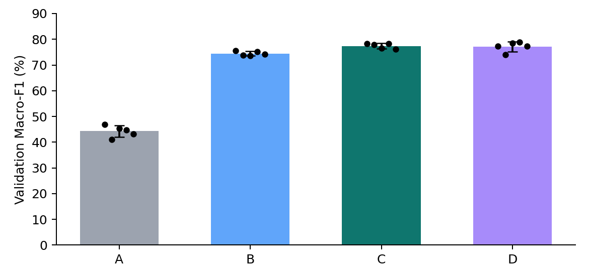
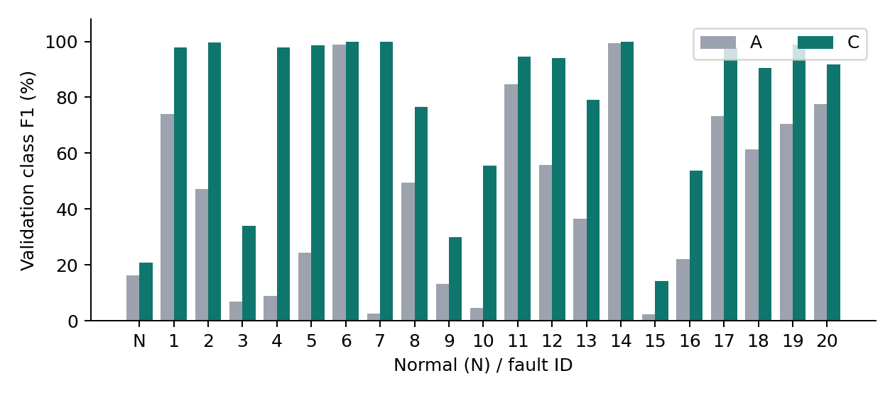
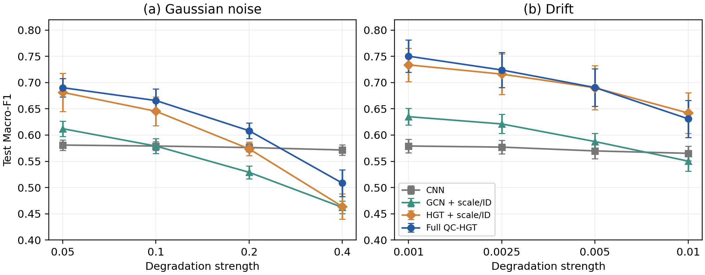

# Graph Learning with Quality and Consistency Awareness for Safety Risk Identification

Wu Zhou, Yuxiang Wang, Jisheng Qin*, Zijie Liu and Ruibing Zhao 
School of Artificial Intelligence, Chuzhou University, Chuzhou, Anhui, China 
Corresponding author: jisheng.qin@chzu.edu.cn

*Updated review draft, 20 November 2026. The planned 60 evaluation tasks, including 40 new training runs, are complete. Tables I and II report the new five-seed held-out results; the historical November 16 draft is retained separately. This is not final camera-ready formatting.*

## Abstract

Process-variable graphs support fault classification when chemical process measurements are degraded. We study a quality- and consistency-aware heterogeneous graph model (QC-HGT) on the 21-class Tennessee Eastman Process extended500 benchmark. The enhanced input combines fixed training-set standardization with physical-variable and process-unit identities. Under clean training, five-seed tests yield Macro-F1 0.7542 ± 0.0276 on clean observations and 0.7161 ± 0.0254 averaged over single-degradation conditions, the highest means among the evaluated CNN, GCN, HGT, and QC-HGT configurations. Under mixed-degradation training, the full model achieves 0.7804 ± 0.0112 on clean data, 0.7729 ± 0.0143 on seen degradations, and 0.7748 ± 0.0108 on unseen combinations. The latter improves over a contemporaneous original-input control (0.4444 ± 0.0208). Controlled same-backbone ablations show a smaller incremental full-model gain of 1.34–1.39 percentage points over disabling both modules; either module alone does not improve the mean. These findings distinguish the large representation gain from the additional joint-module contribution. Accuracy remains below Macro-F1, normal-condition false alarms remain high, and the computational cost is substantially higher than that of native graph baselines. The evidence supports improved classification under the specified budget and synthetic degradations, rather than deployment readiness or superiority to untested recent methods.

**Index terms:** fault diagnosis; heterogeneous process graph; data quality; evidence consistency; input representation; Tennessee Eastman Process.

## I. Introduction

Chemical process measurements reflect interactions among material flows, control actions, and connected equipment [1]. Process-topology graph models make these dependencies available to fault classifiers [2], [3]. However, degraded measurements can propagate through graph aggregation. A small attention weight can reflect either unreliable observations or incompatible evidence between connected variables; these are distinct modeling questions.

Graph learning with missing features [4], statistical process monitoring [5], graph convolution [6], graph attention [7], relational graph convolution [8], and heterogeneous graph transformers [9] provide relevant foundations. QC-HGT combines a heterogeneous process graph with separately supervised node-reliability and relation-consistency branches. At inference, these branches use observable inputs rather than injected degradation parameters or fault labels.

This study separates three empirical questions: whether the input representation preserves useful fault information; whether reliability and consistency contribute beyond a shared backbone and input representation; and whether the resulting classifier generalizes to held-out degradation conditions. A validation-based representation study selects candidate C before held-out inspection. Completed P1/P2 tests and same-backbone ablations then address generalization and incremental module contributions.

The study provides (i) a process graph with six directed relation types and an input representation preserving fixed physical identities, (ii) observable-input reliability and relation-consistency mechanisms, and (iii) five-seed clean-training and mixed-degradation evaluations with controlled input and module comparisons. The full configuration has the highest reported mean Macro-F1, but this does not establish independent benefits from each branch or statistical significance.

## II. Method

### A. Window graphs and classification

A run contains 52 process variables. A sample is a window of W = 30 observations, with endpoint label Normal or IDV1–IDV20. Windows are constructed after independent runs have been assigned to training, validation, or testing. The classifier maps a window graph G = (V, E, X, R) to 21 class probabilities.

The graph contains 41 Sensor nodes, 11 Actuator nodes, six Process Unit nodes, and 480 directed edges. Its fixed process mapping is unchanged in the input experiments.

| Relation | Directed endpoints | Reverse handling |
| --- | --- | --- |
| monitors | Sensor → Process Unit | monitored_by |
| controls | Actuator → Process Unit | controlled_by |
| flows_to | Process Unit → Process Unit | None |
| co_monitors | Sensor → Sensor | Both directions |
| monitored_by | Process Unit → Sensor | Reverse of monitors |
| controlled_by | Process Unit → Actuator | Reverse of controls |

### B. Original and enhanced input representations

Each Sensor or Actuator has seven window statistics: mean, population standard deviation, minimum, maximum, linear trend, last value, and last-minus-first difference. Invalid observations are excluded; invalid endpoints use the configured zero fill. Process Unit statistics are averages over attached variables. The original representation applies LayerNorm to the seven statistics before type-specific projection to 64 dimensions. It has no physical-variable or unit-ID embeddings.

The enhanced representation fits a separate mean and scale for each variable using only valid, uncorrupted observations covered by the selected training windows. Overlapping windows do not count a run/time observation more than once. All training classes are included in this fit. The transformation is:

**x′(j,t) = [x(j,t) − μ(j,train)] / max[σ(j,train), 10⁻⁶].**

Degradations are applied in physical units before this fixed transformation. Observation masks are retained, and statistics are computed from transformed valid observations. Validation and test data do not refit the scaler. The scaler and its fingerprint are saved with the checkpoint. Only the seven-statistic input LayerNorm is removed; the quality-descriptor normalization is retained. The quality branch continues to use observable descriptors from physical-unit inputs.

Physical-variable identities are encoded by 16-dimensional learned embeddings shared across the 52 variables; process-unit identities use eight dimensions. Sensor and Actuator statistics are concatenated with their variable and associated-unit embeddings; Process Unit statistics use their unit embedding. The resulting vectors are projected to 64 dimensions. IDs represent fixed physical identities, never fault labels, run identifiers, or sample indices.

Four cumulative variants are compared: A, the original input; B, fixed scaling and removal of input LayerNorm; C, B plus identities; and D, C plus a shared temporal encoder. D encodes standardized observations, masks, and valid adjacent differences with two causal convolution layers, kernel size three, dilations one and two, and a 32-dimensional output. C was selected using validation Macro-F1 before the new test evaluations. The main test tables use this enhanced representation; A/B/D remain input-study controls.

### C. Quality estimation

Noise, drift, random or continuous missingness, and boundary-padded time shifts are applied to selected process variables. A training quality target is the clipped value one minus equally weighted penalties for normalized noise magnitude, actual missing fraction, drift magnitude, and shift magnitude. The four weights are 0.25; normalization limits are 0.4, 0.4, 0.01, and eight, respectively.

Six observable descriptors are used: missing rate, adjacent-difference variance, high-frequency energy ratio, standardized historical deviation, repeated-value proportion, and a timestamp-delay component fixed at zero in these experiments. A LayerNorm–MLP–sigmoid estimator produces Sensor reliability r. Its auxiliary loss Lq is mean squared error against the training quality target over the 41 sensors. Actuator and Process Unit reliability is fixed to one. Predicted reliability is not a sensor-health measurement, and injected degradation parameters are not inference inputs.

### D. Relation-conditioned consistency and attention

For each directed relation, learned source and target projections and a relation embedding form the input to a consistency MLP. Its logit uses the projected source, projected target, relation embedding, and absolute source–target difference; sigmoid gives compatibility c. Positive pairs are true edges within one window. Negative pairs use a non-neighbor target, a target from the next batch window, or a three-step boundary-padded shifted target; unavailable negatives are omitted. Positive and pooled-negative groups receive equal weight in the binary cross-entropy loss Lc, averaged across relations and layers. Sampling does not access fault labels. This compatibility is neither a causal effect nor merely feature similarity.

Relation-aware attention adds quality and consistency adjustments to the base logit:

**ẽ(i,j,r) = e(i,j,r) + λ(r) log[r(j) + 10⁻⁸] + γ(r)c(i,j).**

Softmax is taken over incoming neighbors for each target and relation. Relation messages and a type-specific self projection are combined, followed by ELU and dropout. The coefficients λ and γ are initialized at one but have unconstrained signs. Consequently, suppression of unreliable messages is conditional on a positive learned λ; it is not guaranteed by the parameterization.

### E. Readout and learning objective

Type-wise mean pooling concatenates Sensor, Process Unit, and Actuator embeddings into a 192-dimensional graph representation. An MLP produces 21 class probabilities. The complete model optimizes ordinary unweighted classification cross-entropy plus auxiliary losses:

**L = Lcls + 0.5 Lq + 0.2 Lc.**

A module ablation disables both the corresponding attention term and its auxiliary loss. Native HGT has a different backbone and is an external comparator. A separate QC-backbone configuration with both modules disabled supplies the strict no-module control.

## III. Experiments

### A. Dataset, protocols, and reproducibility

TEP extended500 [10] has 52 variables and 21 classes sampled at three-minute intervals. Source training runs are divided 80/20 before windowing; source test runs are retained. Available run counts are 8,400/2,100/10,500 for training/validation/testing. Experiments use stride one and a fixed budget of 5,000/2,000/2,000 sampled windows. Candidate selection uses only training and validation observations, followed by separate held-out testing. The 2,000-window test cap applies to each evaluated scenario or P2 group. These are budget-limited experiments, not training on all available windows.

All runs use seeds 0–4, AdamW, learning rate 0.001, weight decay 0.0001, batch size 128, and at most 30 epochs. Early stopping monitors validation Macro-F1 with patience five and minimum improvement 0.0001; the best validation checkpoint is retained. All current runs use deterministic CUDA execution on an RTX 3080 Ti. Historical runtime measurements from other hardware are excluded from the current cost comparison.

P1 trains and validates on clean observations, then tests clean and individual degradation conditions. P2 trains with mixed known degradations and validates only on seen conditions. Drift + Time Shift, Noise + Continuous Missing, and Random Missing + Time Shift are reserved for unknown-combination testing. P2 test endpoints are Clean, Seen Degradation, and Unseen Combination; these correspond to the saved clean, known-group, and unseen-combination evaluations.

Macro-F1 averages all 21 class F1 scores, assigning zero to undefined scores. Unless explicitly stated otherwise, values are on the 0–1 scale and report mean ± sample standard deviation (ddof = 1) over five seeds. Each seed is scored separately; predictions are not pooled across seeds. Validation values are used for checkpoint and candidate selection and must not be interpreted as unbiased test estimates. Improvements are descriptive; no significance claim is made from seed means alone.

For the new A/B/C/D runs, saved manifests confirm identical selected windows, raw selected observations, source files, and training rules within each seed. B/C/D also share the fitted scaler. All variants are initialized and trained independently. Different parameter counts and early stopping can change actual computation despite shared budget limits. The completed evaluation comprises 20 existing A/B/C/D checkpoints tested under P2, 15 new P2 QC-module training runs, 20 P1 training runs, and five P2 native-HGT training runs. The existing five C checkpoints supply the full-model P2 row. Test-window selections agree across compared models within each protocol and seed; C-based graph comparisons also share training/validation windows and fitted scales. The selected clean test sample has 343 Normal windows out of 2,000, with 76–87 per fault class. Accuracy and Macro-F1 therefore need not coincide.

### B. Completed held-out comparisons and module ablations

Table I reports the current P1 tests. GCN and native HGT receive the same seven fixed-scale statistics, 16-dimensional variable IDs, and eight-dimensional unit IDs; unit nodes use a zero-filled variable-ID slot. Their architectures remain distinct from QC-HGT. CNN retains its temporal input and within-window normalization. Consequently, the table compares complete configurations rather than isolating architecture under identical encoders.

Within each seed, Noise, Drift, and Time Shift average four intensities, and Missing averages eight random/continuous conditions. Average Robustness is the equal-weight average of five degradation subtypes (noise, random missingness, continuous missingness, drift, and shift), each averaged over four strengths. It excludes Clean and is not the unweighted average of the four displayed degradation columns. Only after this aggregation are five-seed means and sample standard deviations calculated.

**Table I. Current P1 held-out test Macro-F1, mean ± sample SD over five seeds. Bold denotes the highest displayed mean.**

| Model | Clean | Noise | Missing | Drift | Time Shift | Avg. Robustness |
| --- | --- | --- | --- | --- | --- | --- |
| CNN | 0.5816 ± 0.0102 | 0.5770 ± 0.0091 | 0.5754 ± 0.0110 | 0.5728 ± 0.0134 | 0.5513 ± 0.0130 | 0.5704 ± 0.0112 |
| GCN + fixed scale/ID | 0.6369 ± 0.0171 | 0.5456 ± 0.0119 | 0.6368 ± 0.0173 | 0.5986 ± 0.0162 | 0.6379 ± 0.0160 | 0.6111 ± 0.0155 |
| Native HGT + fixed scale/ID | 0.7366 ± 0.0303 | 0.5911 ± 0.0247 | 0.7372 ± 0.0302 | 0.6955 ± 0.0373 | 0.7367 ± 0.0299 | 0.6996 ± 0.0301 |
| Full QC-HGT (C input) | **0.7542 ± 0.0276** | **0.6182 ± 0.0181** | **0.7540 ± 0.0270** | **0.6990 ± 0.0331** | **0.7552 ± 0.0275** | **0.7161 ± 0.0254** |

Full QC-HGT has the highest mean in all six displayed aggregates. Its clean score exceeds identity-enhanced HGT by 1.76 percentage points and CNN by 17.26 points; its average robustness exceeds HGT by 1.65 points. These aggregate rankings do not hold at every intensity: at noise strength 0.4, CNN scores 0.5716 versus QC-HGT 0.5084, and at drift strength 0.01 native HGT scores 0.6420 versus QC-HGT 0.6309. Figure 3 makes these limits visible. Missingness and shifts leave the aggregate-statistic graph classifiers comparatively stable under the tested perturbations; this is not evidence of robustness to arbitrary outages or misalignment.

**Table II. Current P2 held-out test Macro-F1, mean ± sample SD over five seeds. All graph rows use fixed-scale and identity-enhanced inputs.**

| Model | Clean | Seen Degradation | Unseen Combination |
| --- | --- | --- | --- |
| Native HGT + fixed scale/ID | 0.7495 ± 0.0293 | 0.7407 ± 0.0282 | 0.7416 ± 0.0304 |
| QC backbone, no modules | 0.7665 ± 0.0221 | 0.7590 ± 0.0230 | 0.7614 ± 0.0231 |
| QC backbone + Quality only | 0.7626 ± 0.0228 | 0.7560 ± 0.0220 | 0.7542 ± 0.0223 |
| QC backbone + Consistency only | 0.7578 ± 0.0368 | 0.7486 ± 0.0410 | 0.7513 ± 0.0431 |
| Full QC-HGT (C input) | **0.7804 ± 0.0112** | **0.7729 ± 0.0143** | **0.7748 ± 0.0108** |

The full model improves over native HGT by 3.10, 3.22, and 3.32 percentage points on Clean, Seen Degradation, and Unseen Combination, respectively. The stricter comparison against the same QC backbone with both modules disabled yields gains of 1.39, 1.39, and 1.34 points. Full-model scores exceed that control for four, five, and four of the five paired seeds, respectively. Quality-only and Consistency-only both have lower means than the no-module control across all three endpoints. Thus the observed full-configuration benefit does not establish that each component independently improves classification, nor prove a synergistic interaction or statistical significance.

Tables I and II replace the historical main tables for this revised method. They are computed exclusively from completed current tests; historical original-input values remain in the archived draft and are not pooled with these observations. The same-run input-A comparison in Table IV is the appropriate control for quantifying the representation improvement.

### C. Five-seed input-representation study

Table III reports completed P2 validation results from 20 independent runs. All groups retain the complete quality and consistency mechanisms. The table isolates cumulative input choices, not those modules' independent contributions.

**Table III. New P2 validation results; mean ± sample SD. Time includes training and validation.**

| Group | Representation | Accuracy | Macro-F1 | Parameters | Mean time (h) |
| --- | --- | --- | --- | ---: | ---: |
| A | Original statistics + input LayerNorm | .4641 ± .0201 | .4426 ± .0219 | 235,110 | 2.73 |
| B | Fixed scaling, no input LayerNorm | .7427 ± .0093 | .7449 ± .0086 | 235,068 | 2.40 |
| C | B + physical identities | **.7700 ± .0095** | **.7740 ± .0100** | 239,532 | 2.65 |
| D | C + shared TCN | .7696 ± .0185 | .7715 ± .0191 | 249,100 | 3.51 |

B improves on A by 30.23 percentage points in Macro-F1, and C improves on B by 2.92 points; both comparisons are positive for all five paired seeds. The A-to-B contrast changes scaling and input LayerNorm jointly and cannot identify either operation's isolated effect. C improves on A by 33.15 points, while its seed SD decreases from 2.19 to 1.00 points. Its parameter count increases by 1.88%, and mean time per epoch is approximately 328.5 s versus 327.8 s for A.

D improves over C for three seeds and decreases for two, yielding a mean difference of −0.25 points. Its mean time per epoch is 464.5 s, about 41.4% higher than C. Actual epoch counts are A: 30/30/30/30/30; B: 30/23/24/30/24; C: 30/30/25/30/30; and D: 30/16/30/30/30. Total runtime differences partly reflect early stopping, not inference efficiency. These validation findings motivated selecting C before held-out testing under the present budget; they do not exclude benefits from TCN under a different training budget.

*Figure 1. Completed P2 validation Macro-F1. Dots are individual seeds; bars show means and error bars show sample SD. These values are not held-out test performance.*

### D. Held-out input gains, accuracy, and false alarms

Table IV evaluates all A/B/C/D checkpoints on the same P2 test endpoints after candidate C was fixed from validation. These are distinct from the validation values in Table III. C exceeds the original-input A control by 32.61, 32.49, and 33.04 percentage points on Clean, Seen Degradation, and Unseen Combination. The A-to-B increase remains much larger than the B-to-C increase, supporting the importance of fixed scaling and removal of input LayerNorm together; their separate contributions are not isolated. D does not exceed C in any of the three mean test scores. No test-based candidate reselection was performed.

**Table IV. P2 input-study held-out test Macro-F1, mean ± sample SD over five seeds. All variants retain both QC modules.**

| Input variant | Clean | Seen Degradation | Unseen Combination |
| --- | --- | --- | --- |
| A | 0.4544 ± 0.0235 | 0.4480 ± 0.0192 | 0.4444 ± 0.0208 |
| B | 0.7474 ± 0.0054 | 0.7440 ± 0.0050 | 0.7437 ± 0.0050 |
| C | 0.7804 ± 0.0112 | 0.7729 ± 0.0143 | 0.7748 ± 0.0108 |
| D | 0.7753 ± 0.0108 | 0.7714 ± 0.0157 | 0.7703 ± 0.0138 |

**Table V. Full QC-HGT (C input) P2 test diagnostics, mean ± sample SD over five seeds. Higher Accuracy is better; lower FAR, ECE, and NLL are better.**

| Test condition | Accuracy | Normal FAR | ECE | NLL |
| --- | --- | --- | --- | --- |
| Clean | 0.7144 ± 0.0171 | 0.7528 ± 0.0955 | 0.0274 ± 0.0066 | 0.7147 ± 0.0199 |
| Seen Degradation | 0.7094 ± 0.0180 | 0.7609 ± 0.0891 | 0.0251 ± 0.0064 | 0.7322 ± 0.0272 |
| Unseen Combination | 0.7097 ± 0.0142 | 0.7673 ± 0.0720 | 0.0249 ± 0.0057 | 0.7301 ± 0.0222 |

The full model's clean Accuracy is 71.44%, while its clean Macro-F1 is 78.04%; these quantify different aspects of the class distribution and must not be interchanged. FAR is the fraction of truly normal windows classified as any fault by the multiclass argmax rule, not performance at a separately calibrated alarm threshold. Full-model clean FAR is 75.28%, compared with 70.55% for original-input A, 65.54% for native HGT, and 80.17% for the no-module QC control. Thus the full model improves false alarms relative to its no-module control, but not relative to A or native HGT. Its 76.73% FAR on unseen combinations remains a substantial limitation for monitoring applications.

The validation class analysis is retained separately in Figure 2. C improves mean validation F1 for all 21 classes relative to A; the largest changes include IDV7 (2.68% to 100.00%), IDV4 (8.84% to 97.84%), and IDV5 (24.43% to 98.55%). Normal, IDV3, IDV9, and IDV15 remain difficult. These class-specific numbers are validation diagnostics and are not substituted for held-out class scores.

*Figure 2. Per-class validation F1, averaged across five seeds for A and C. This retained input-study diagnostic is distinct from the held-out metrics in Tables I, II, IV, and V.*

*Figure 3. P1 held-out Macro-F1 under increasing noise and drift. Points and error bars represent five-seed means and sample standard deviations. Full QC-HGT leads the aggregate comparisons, but not every individual severity.*

The current full model's mean predicted sensor reliability is 0.9936, 0.9931, and 0.9930 on P2 Clean, Seen Degradation, and Unseen Combination, respectively. These near-saturated averages include unaffected sensors and do not demonstrate selective damage identification. An affected-versus-unaffected sensor analysis remains outside the completed evaluation. Classification gains alone do not establish calibrated reliability estimation or causal interpretation of the consistency branch.

### E. Computational cost and completed evaluation scope

**Table VI. Current P1 model size and training cost. Time includes validation and excludes held-out testing.**

| P1 model | Parameters | Mean training + validation (h) | Epochs, seeds 0–4 |
| --- | --- | --- | --- |
| CNN | 44,501 | 0.059 | 20/19/27/24/25 |
| GCN + fixed scale/ID | 34,501 | 0.082 | 30/30/30/30/30 |
| Native HGT + fixed scale/ID | 158,907 | 0.071 | 30/25/21/21/20 |
| Full QC-HGT (C input) | 239,532 | 2.225 | 14/30/30/30/18 |

Full QC-HGT requires about 2.225 hours of training and validation per P1 seed, versus 0.071 hours for native HGT and 0.059 hours for CNN. The approximately 31.5-fold total-time ratio to native HGT depends on both implementation and actual epoch counts; it is not an inference-latency ratio. The input-C parameter overhead relative to input A is small (1.88%, Table III), but QC-HGT itself remains substantially more expensive than these baselines. Inference latency and memory-normalized efficiency were not benchmarked.

All 60 planned tasks completed, including held-out evaluation after each new training run. The final three P2 HGT seeds were recovered after an interruption: the incomplete seed 2 was rerun from initialization with the unchanged configuration, and seeds 3 and 4 then ran normally. Completed runs were retained, and interrupted outputs were archived. Saved records include selected windows, configuration/source fingerprints, fitted scalers, best checkpoints, and test predictions. The updated tables aggregate each seed separately and use sample standard deviations; standard deviations across severities are not averaged.

The completed model matrix contains CNN, GCN, native HGT, and QC-HGT variants. It does not contain newly implemented recent external models. Accordingly, these results support comparisons within the evaluated matrix, not a state-of-the-art claim. Additional models would require matched classes, run splits, window construction, degradation conditions, and comparable tuning and training budgets.

### F. Limitations

Evidence is restricted to one simulated process dataset, synthetic degradation rules, and a small fixed window budget. The test set was held out during candidate selection, but broader datasets and real sensor failures remain untested. Matching sampled windows and graph inputs does not eliminate architecture, initialization, compute, and early-stopping differences. CNN uses a different temporal representation and normalization. The full model's advantage is a descriptive mean comparison over five seeds; no significance test is claimed, and overlapping windows must not be treated as independent observations in future uncertainty analyses. Standalone modules fail to improve the no-module mean, severe noise/drift can reverse rankings, normal-condition FAR remains high, and QC-HGT has a substantial training-cost penalty. These constraints prevent claims of uniformly improved monitoring, calibrated sensor-health estimation, or deployment readiness.

## IV. Conclusions

Fixed training-set scaling and physical identities substantially improve QC-HGT's fault classification in the completed TEP experiments. Under clean training, enhanced QC-HGT reaches clean Macro-F1 0.7542 ± 0.0276 and average robustness 0.7161 ± 0.0254, the highest aggregate means among the evaluated models. Under mixed-degradation training, it achieves 0.7804 ± 0.0112, 0.7729 ± 0.0143, and 0.7748 ± 0.0108 on Clean, Seen Degradation, and Unseen Combination. Same-backbone ablations separate the large representation improvement from the smaller full-module gain of approximately 1.3–1.4 percentage points. Neither standalone module improves the no-module mean, so independent component benefits are not established. High false-alarm rates, severity-dependent rankings, and substantial computational cost remain unresolved. Comparisons with recent external models and practical safety-risk validation require additional evidence.

## References

[1] J. J. Downs and E. F. Vogel, “A plant-wide industrial process control problem,” Computers & Chemical Engineering, vol. 17, no. 3, pp. 245–255, 1993. doi: 10.1016/0098-1354(93)80018-I.

[2] D. Wu and J. Zhao, “Process topology convolutional network model for chemical process fault diagnosis,” Process Safety and Environmental Protection, vol. 150, pp. 93–109, 2021. doi: 10.1016/j.psep.2021.03.052.

[3] M. Jia, J. Hu, Y. Liu, Z. Gao, and Y. Yao, “Topology-guided graph learning for process fault diagnosis,” Industrial & Engineering Chemistry Research, vol. 62, no. 7, pp. 3238–3248, 2023. doi: 10.1021/acs.iecr.2c03628.

[4] H. Taguchi, X. Liu, and T. Murata, “Graph convolutional networks for graphs containing missing features,” Future Generation Computer Systems, vol. 117, pp. 155–168, 2021. doi: 10.1016/j.future.2020.11.016.

[5] S. J. Qin, “Statistical process monitoring: Basics and beyond,” Journal of Chemometrics, vol. 17, nos. 8–9, pp. 480–502, 2003. doi: 10.1002/cem.800.

[6] T. N. Kipf and M. Welling, “Semi-supervised classification with graph convolutional networks,” ICLR, 2017. arXiv:1609.02907.

[7] P. Veličković et al., “Graph attention networks,” ICLR, 2018. OpenReview: rJXMpikCZ.

[8] M. Schlichtkrull et al., “Modeling relational data with graph convolutional networks,” ESWC, pp. 593–607, 2018. doi: 10.1007/978-3-319-93417-4_38.

[9] Z. Hu, Y. Dong, K. Wang, and Y. Sun, “Heterogeneous graph transformer,” The Web Conference, pp. 2704–2710, 2020. doi: 10.1145/3366423.3380027.

[10] C. A. Rieth, B. D. Amsel, R. Tran, and M. B. Cook, “Additional Tennessee Eastman Process Simulation Data for Anomaly Detection Evaluation,” Harvard Dataverse, version 1.0, 2017. doi: 10.7910/DVN/6C3JR1.
